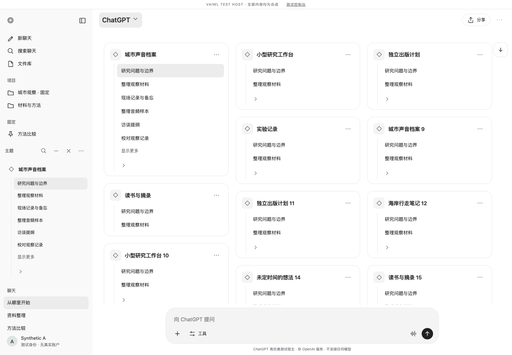
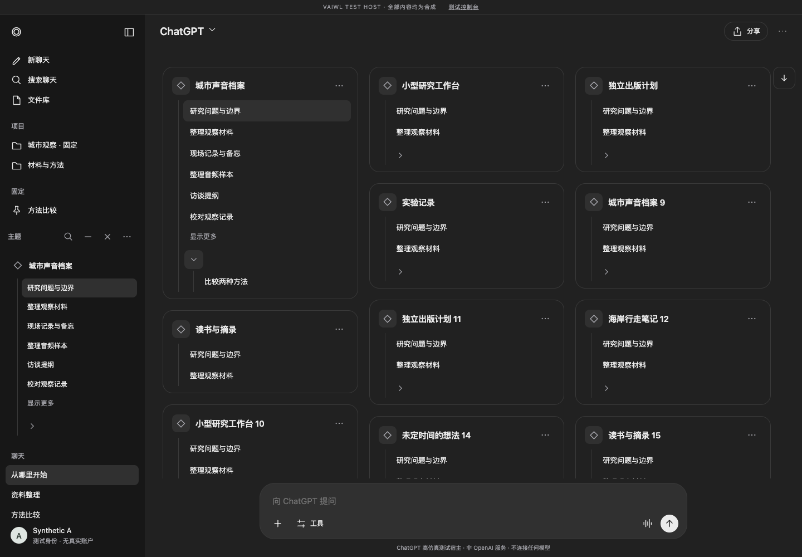
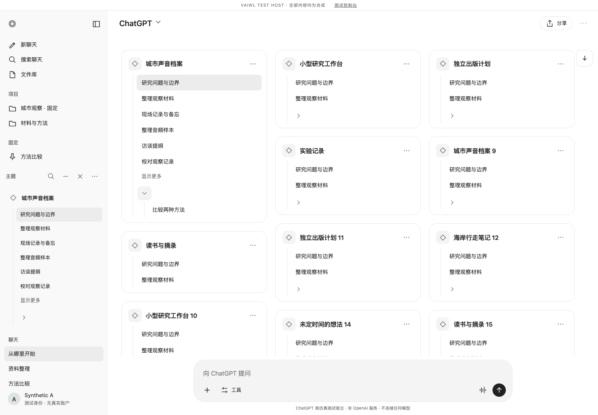
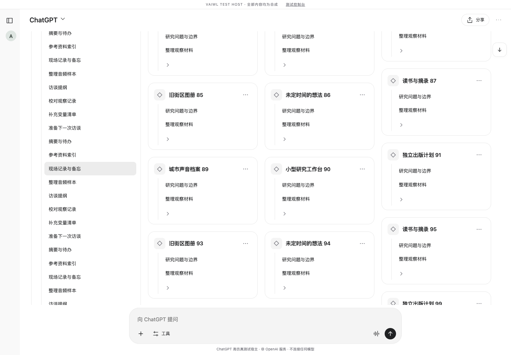
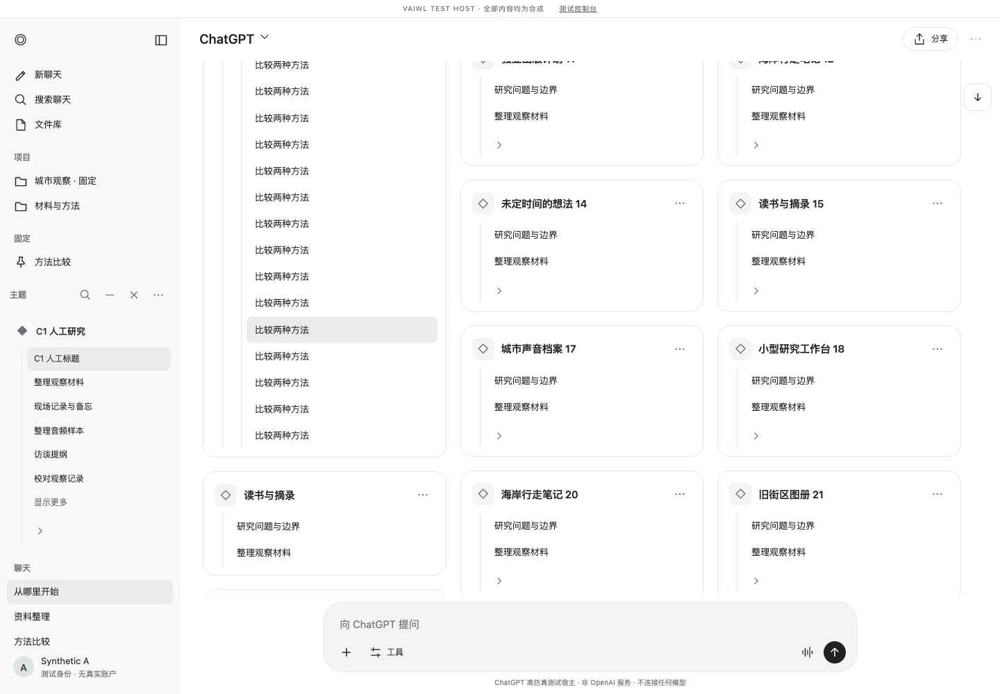
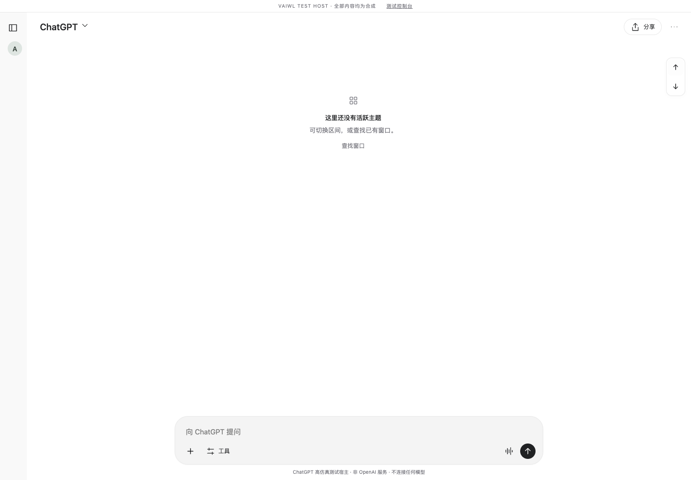
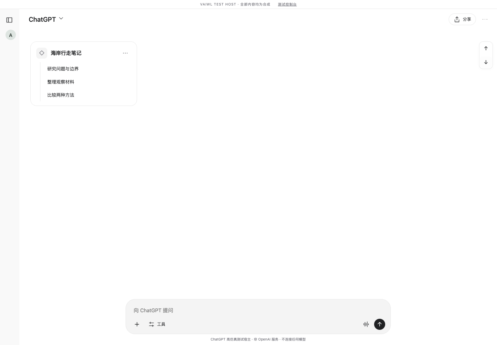
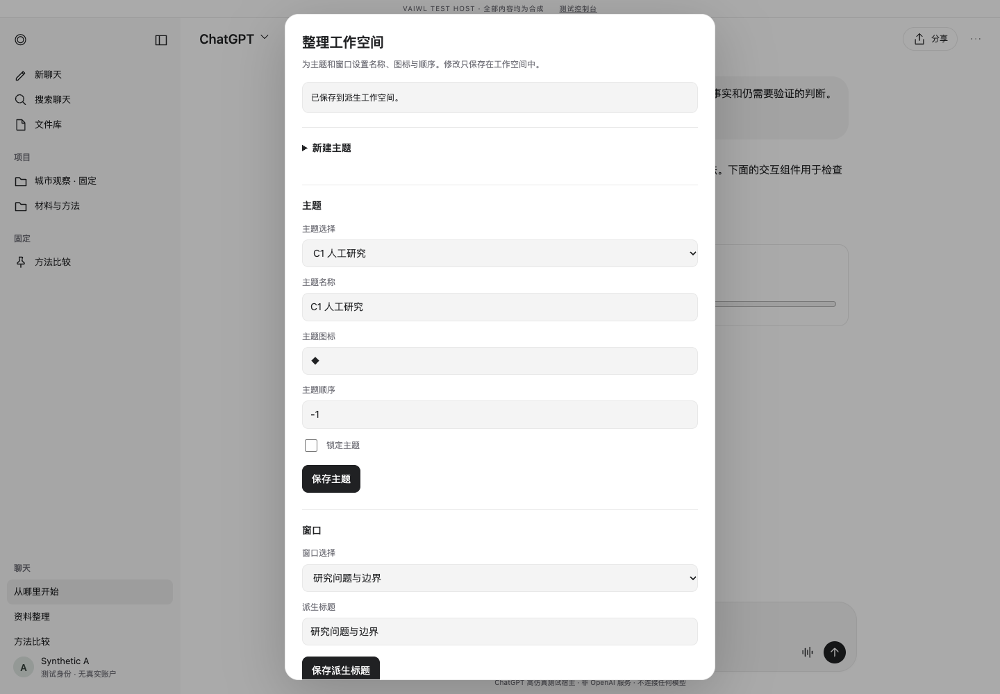
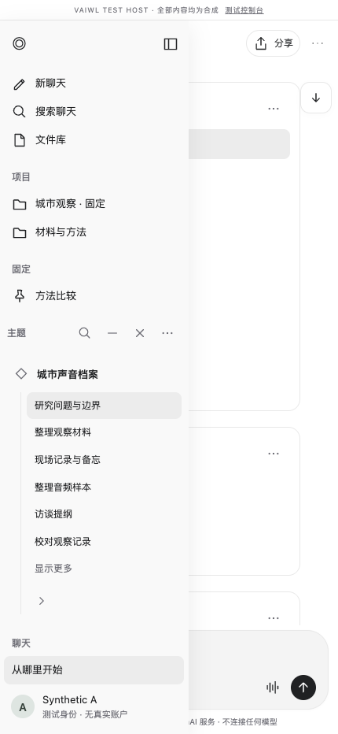
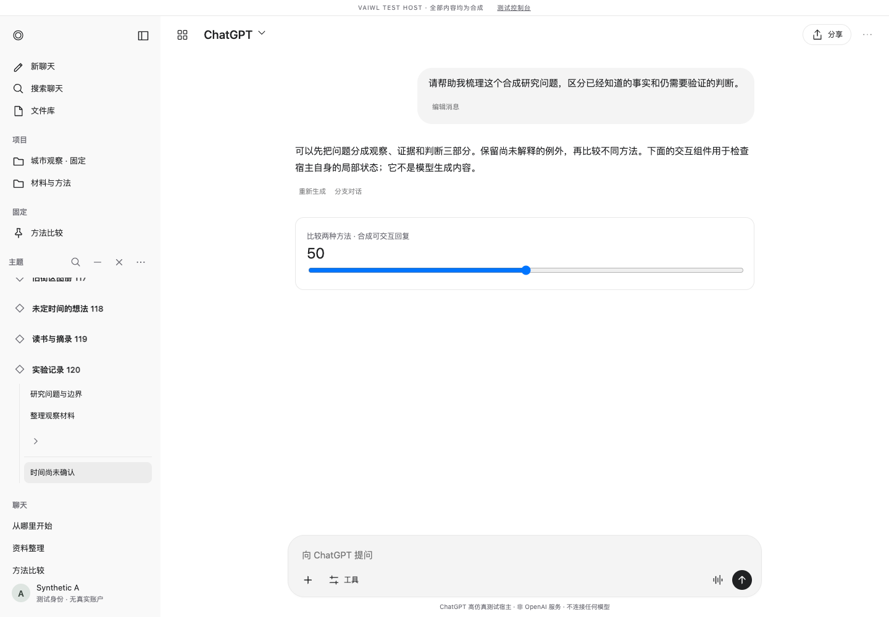

# C1 实际 Chrome MV3 界面画廊

全部图片来自本机headless Chrome154、新隔离Profile和已加载MV3；宿主与内容均明确为合成。运行时代码20a64343，真实extension IndexedDB。没有Figma/静态HTML替身或私人内容。单独最终UI9/9；截图按原样保存，未修图。

## 桌面 · 1440 × 1000

## 窄屏 · 430 × 932，原生抽屉关闭

## 深色 · 使用宿主真实深色变量

## 父主题内旧窗口局部展开

## 126近期窗口完整展开 · 其他列仍连续

## 17旧窗口完整展开 · 未知仍独立

## 空历史段 · 不静默跳过

## 较早段 · 上下相邻导航

## 人工编辑 · 共用B3/B4命令与草稿

## 窄屏原生抽屉打开

## 最远已知引用 · 真实原生阅读及新标签

